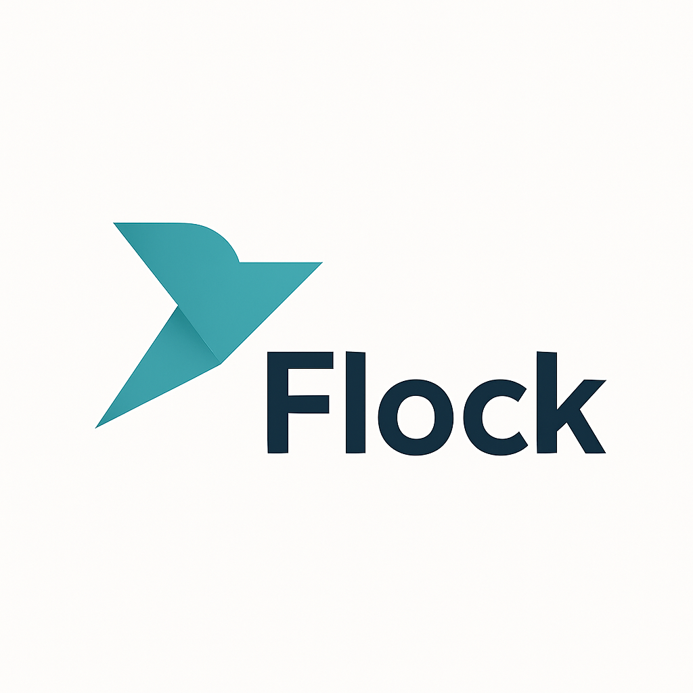

  

<h1 align="center">Flock</h1>

  <em>Decentralized service discovery platform</em>

**Flock** is a lightweight, decentralized peer-to-peer service discovery layer for distributed systems.  
It eliminates the need for centralized registries like Consul or Eureka and can complement or extend Kubernetes-based discovery mechanisms in large-scale or hybrid environments.

## 🚀 Motivation

Modern distributed systems commonly rely on centralized coordination services such as Consul, Eureka, or CoreDNS (in Kubernetes) to enable service discovery and health monitoring.
These platforms provide robust and production-proven mechanisms for name resolution, service registration, and fault detection — forming the backbone of most cloud-native architectures today.

However, in certain scenarios — particularly at very large scales or in heterogeneous environments — the reliance on a central control plane can introduce operational complexity and, in some cases, become a potential performance bottleneck or single point of failure.
This is especially relevant for systems deployed across multiple clusters, regions, or constrained edge networks, where maintaining consistent global state may be challenging.

## 🧠 Core Philosophy
Flock explores an alternative approach: instead of centralizing discovery, it distributes this responsibility evenly among all participating nodes.
By leveraging a lightweight, SWIM-inspired gossip protocol, Flock allows services to autonomously exchange peer information, detect failures, and maintain eventual consistency — without depending on a centralized registry or orchestration layer.

## 🧩 Use Cases

| Environment | Description | Why Flock fits |
|--------------|-------------|----------------|
| 🧱 **Large clusters** | Systems where CoreDNS, Consul, Eureka or any other centralize solution could be a bottleneck | Acts as an overlay discovery mesh across clusters |
| 🖥️ **VM-based / Bare-metal microservices** | Legacy or minimal infrastructures without Kubernetes | No control plane required; runs as a single agent per host |
| 🌐 **Edge / IoT networks** | Distributed devices with intermittent connectivity | Peer-to-peer, self-healing, low resource consumption |
| ☁️ **Hybrid & multi-cloud systems** | Multi-region or multi-cluster deployments | Enables discovery across heterogeneous environments |

---

 Built with ❤️ in Go for distributed systems enthusiasts 

